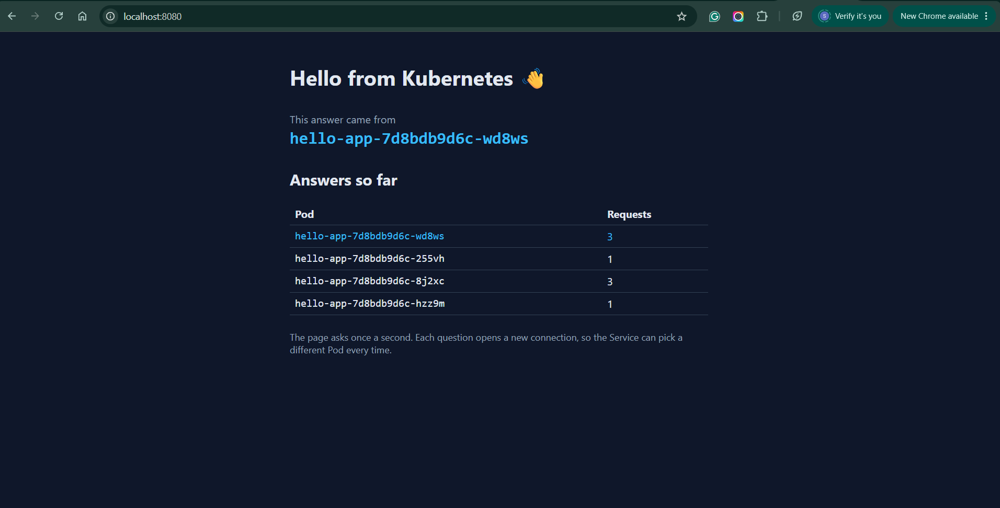

# Lab 2 — hello-app on Kubernetes

Your copy of this repository is your submission. The lab sheet is on the course site; this file is where you record what you did.

What's here:

| File | What it is |
|---|---|
| `src/`, `index.html` | a small React page that shows which Pod answered |
| `nginx.conf` | serves the page, and answers `/whoami` with the Pod name |
| `Dockerfile` | builds the page, then serves it with nginx on port 80 |

You don't change any of these. You add `hello-app.yaml` and fill in the sections below.

## Before you push, check

- [x] `hello-app.yaml` is in the root of this repository
- [x] `screenshot.png` is in the root of this repository
- [x] every section below is filled in

---

## 1. My image

Docker Hub image I deployed (for example `ravi123/hello-app:v1`):

```
such1t/hello-app:v1
```

## 2. Pods across nodes

Output of `kubectl get pods -o wide` after you applied `hello-app.yaml`:

```
NAME                         READY   STATUS    RESTARTS   AGE   IP           NODE              NOMINATED NODE   READINESS GATES
hello-app-7d8bdb9d6c-255vh   1/1     Running   0          31m   10.244.2.7   desktop-worker    <none>           <none>
hello-app-7d8bdb9d6c-8j2xc   1/1     Running   0          29m   10.244.1.7   desktop-worker2   <none>           <none>
hello-app-7d8bdb9d6c-hzz9m   1/1     Running   0          31m   10.244.1.6   desktop-worker2   <none>           <none>
hello-app-7d8bdb9d6c-wd8ws   1/1     Running   0          31m   10.244.2.8   desktop-worker    <none>           <none>
```

## 3. The Service and its endpoints

Output of `kubectl get service hello-app` and `kubectl get endpointslices -l kubernetes.io/service-name=hello-app`:

```
NAME        TYPE           CLUSTER-IP      EXTERNAL-IP   PORT(S)          AGE
hello-app   LoadBalancer   10.96.217.236   172.21.0.7    8080:31249/TCP   31m

NAME              ADDRESSTYPE   PORTS   ENDPOINTS                                      AGE
hello-app-7tf8j   IPv4          80      10.244.2.7,10.244.1.6,10.244.2.8 + 1 more...   14m
```

## 4. Browser



## 5. The four traps

**Trap 1 — the local image.**
I created the Deployment with `hello-app:v1` and the Pods went to `ErrImagePull`, then `ImagePullBackOff`. The Events said the pull of `docker.io/library/hello-app:v1` failed because that repository doesn't exist. The image was only in my laptop's Docker, and the cluster nodes have their own storage and pull from a registry. Tagging it as `such1t/hello-app:v1` and pushing it to Docker Hub fixed it.

**Trap 2 — the selector typo.**
With the selector `app: helo-app`, the EndpointSlice showed `<unset>` for both PORTS and ENDPOINTS:

```
hello-app-7tf8j   IPv4          <unset>   <unset>     6m58s
```

The Service and the Pods both still existed, but no Pod had the label `helo-app`, so the Service had nowhere to send traffic. Fixing the typo brought the Pod IPs back.

**Trap 3 — the wrong targetPort.**
With `targetPort: 8080`, the EndpointSlice listed the Pod IPs, but with port 8080:

```
hello-app-7tf8j   IPv4          8080    10.244.1.7,10.244.2.7,10.244.1.6 + 1 more...   13m
```

The Service found the Pods, but nginx listens on port 80, so nothing answered on 8080. Changing it back to 80 fixed it. An empty EndpointSlice means a wrong selector; Pods listed on the wrong port means a wrong targetPort.

**Trap 4 — the EXTERNAL-IP address.**
`kubectl get service hello-app` showed `EXTERNAL-IP` as `172.21.0.7`. That address is inside Docker Desktop's private network, so my laptop can't reach it and `http://172.21.0.7:8080` doesn't load. Docker Desktop also publishes the LoadBalancer port on localhost, so I opened `http://localhost:8080` instead. On a cloud provider, EXTERNAL-IP would be a real public address that I could use directly.

## 6. Your YAML vs the generated YAML

Two fields in the `--dry-run=client -o yaml` output that were not in my file are `creationTimestamp` and `strategy`. My file still works without them because they are empty or default values that Kubernetes fills in itself when the object is created. For example, `strategy` defaults to a rolling update, and the cluster sets `creationTimestamp`.
